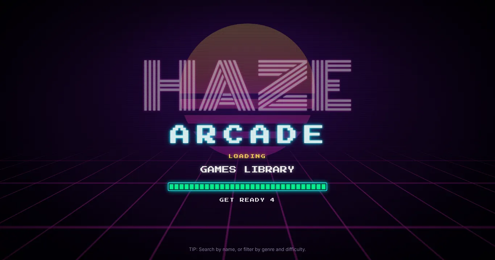
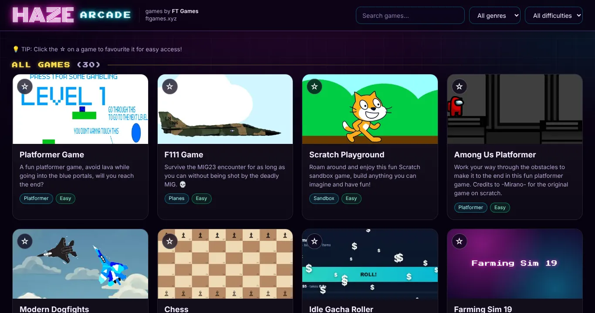
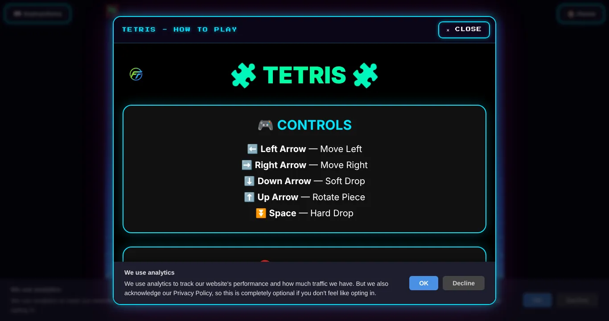

# Haze Arcade

A [PhantomHaze](https://github.com/PhantomHaze-Security/PhantomHaze) extension that puts the whole
[FT Games](https://github.com/FT-Games/ftgames) library in its own **Haze Arcade** tab in the PhantomHaze menu bar,
next to **Logs** and **Web View**.



## Install

1. Download [`dist/Haze Arcade.phext`](dist/Haze%20Arcade.phext).
2. In PhantomHaze open **Settings -> Extensions -> Import extension**, pick the file and click **Save**.
3. Click **Haze Arcade** in the menu bar.

Re-importing a newer file updates the installed extension (same `meta.id`). The extension has no settings.

## What you get

- **The games page, not the homepage.** The tab opens on the FT Games games list: every card of `games.html` in
  the same order, with thumbnails, descriptions, genre and difficulty tags, search, filters and favourites.
- **Games play inside the tab.** Clicking a card downloads the game from the
  [FT-Games/ftgames](https://github.com/FT-Games/ftgames) repository on GitHub and plays it in the arcade. The
  game's own **Home** button takes you back to the games page, and **Instructions** opens in a panel.
- **A neon "Haze Arcade" loading screen** while the games page or a game loads. It stays up until everything has
  loaded (for Scratch games that includes downloading and unpacking the whole project), then keeps on loading for
  another **3 seconds**, with the bar still filling, before showing the game.
- **New games show up by themselves.** Each time the arcade opens it reads `games.html` from the repository, so
  games FT Games adds later appear without a new extension. Without an internet connection it falls back to the
  list built into the file and says so.



## How it fits into PhantomHaze

PhantomHaze shows extension pages with WebView2's `NavigateToString`, which refuses documents over 2 MB, while the
FT Games library is about 260 MB. So the `.phext` holds the arcade itself (the page, 31 small WebP thumbnails and
two tiny fonts, about 370 KB) and downloads each game from `raw.githubusercontent.com` when it is played. Nothing is
loaded from the ftgames.xyz website. Games need an internet connection.

An extension page is an opaque, non-secure document without storage, and GitHub serves HTML, JavaScript and CSS as
`text/plain` (which browsers refuse to run). The arcade bridges that:

| Problem | What Haze Arcade does |
| :-- | :-- |
| GitHub's pages and scripts cannot run as they are served. | The arcade downloads the page and its scripts and builds the game into a frame of its own, with the scripts as `blob:` copies and a `<base>` pointing at the game's folder on GitHub, so pictures, sounds and data load from there. |
| Scratch games load hundreds of files. | Their whole project is downloaded first (eight at a time, with retries), which also drives the loading bar. Downloads are kept for the PhantomHaze session, so a game opens instantly the second time. |
| No storage, cookies or secure-only APIs in extension pages. | A small compatibility layer gives every game `localStorage` and cookies (kept for the session), `crypto.subtle.digest` (SHA-256, which Polytrack needs), `crypto.randomUUID` and a clipboard. |
| Bundles and workers that find their own address (Polytrack's webpack chunks, physics worker and WebAssembly). | They are told their real GitHub address; the physics worker loads its library and WebAssembly from GitHub. |
| Pictures from GitHub are cross-origin, so WebGL refuses them. | Images from GitHub are requested with CORS (which GitHub allows), so games can use them as textures. |
| A game's **Home** link, "Back to safety" and the like would leave the game. | They take the player back to the arcade's games page. Links to other websites open in a new PhantomHaze tab; downloads (saved games) work as usual. |
| **Instructions** uses `window.open`, which PhantomHaze would turn into a tab. | Instructions open in a panel inside the arcade. Retro Pong's Instructions button, which does nothing on the site, works here. |
| Minecraft Classic, the two MakeCode games and the Suggestion Box run on other sites. | They play in the arcade, with an extra **Tab** button that opens the site in a PhantomHaze tab if one ever misbehaves. |
| The site's Farming Sim 19 card has a broken thumbnail. | The arcade ships a picture from the game itself. |

The 2D Platformer card is FT Games' how-to page; its PLAY button opens Google's Jerry Lawson doodle, which
PhantomHaze shows in a new tab. Favourites and game saves last for the PhantomHaze session (PhantomHaze forgets
site data when it closes).



## Development

```
src/arcade.html       the arcade page (template)
src/arcade.js         the games page, loading screen, GitHub downloader, game builder and compatibility layer
src/catalog.json      the game list, generated from FT Games' games.html
src/overrides.json    hand-set values per game (Polytrack's extra scripts, Tab buttons)
src/thumbs/           card thumbnails (generated), src/thumb-overrides/ pictures the site lacks
src/fonts/            HazeNeon and HazePixel subsets with their licences
tools/sync_catalog.py rebuilds catalog.json and thumbs/ from a checkout of FT-Games/ftgames
tools/build.py        writes dist/Haze Arcade.phext and dist/haze-arcade.html
tools/make_fonts.py   makes the font subsets
tests/                PhantomHaze parser check (C#) and end-to-end browser tests (Playwright)
```

After FT Games adds or changes games:

```bash
python3 tools/sync_catalog.py /path/to/ftgames
```

```bash
python3 tools/build.py
```

### Tests

```bash
FTGAMES=/path/to/ftgames PHANTOMHAZE=/path/to/PhantomHaze tests/run.sh
```

The run builds the extension and parses it with PhantomHaze's own `PhextParser` (compiled from the PhantomHaze
sources), which also writes the page exactly as PhantomHaze would render it. The page is then opened in Chromium
as a `data:` URL, the same opaque, non-secure context `NavigateToString` gives it. GitHub is served from the FT Games
checkout with GitHub's real headers; add `--real` to `node tests/arcade.test.js` to use GitHub itself. Every request
to ftgames.xyz fails the run. The suites check:

- **boot**: the loading screen (only ever "LOADING...", 3 more seconds with the bar still filling), cards, search,
  filters and favourites.
- **games**: every card loads from GitHub, every Scratch project loads and runs, instructions open, Tab buttons
  work, and Home goes back.
- **nav**: the 3-second finish after a game loads and on the way back, leaving a game any other way, reloads, saved
  games and downloads, the SHA-256 stand-in against Node's, links to other websites, Minecraft's buttons, the 2D
  Platformer's PLAY, Retro Pong's instructions, a Polytrack race, and cancelling a load.
- **live** (new games in the repository) and **offline**.

## Credits

Games by FT Games. The fonts are subsets of Monoton (Vernon Adams) and Press Start 2P (The Press Start 2P Project
Authors), under the SIL Open Font License 1.1 (see `src/fonts/`), renamed HazeNeon and HazePixel as the licence asks.
